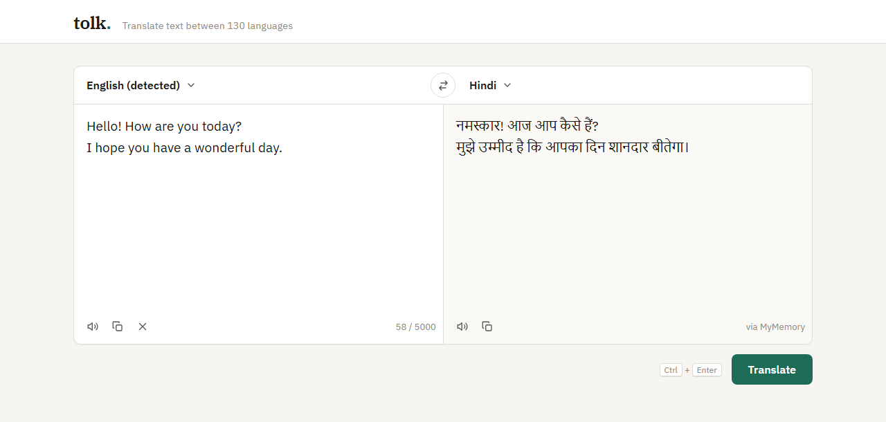

# Tolk – Language Translation Tool

**Tolk** (Dutch and Scandinavian for "interpreter") is a web app that translates text between 130 languages. Enter text, pick the source and target languages, and get the translation instantly, with buttons to copy it or hear it read aloud.

Built for **CodeAlpha AI Internship – Task 1**.



## Features

- Text input with a live character counter (up to 5,000 characters)
- Source and target language dropdowns, including **automatic language detection**
- One-click **swap** of languages (and texts)
- Translated text shown in a dedicated panel, with right-to-left support for Arabic, Hebrew, Urdu, etc.
- **Copy** buttons for the input and the translation
- **Text-to-speech** for the input and the translation
- Keyboard shortcut: <kbd>Ctrl</kbd> + <kbd>Enter</kbd> to translate
- Clear error messages for empty input, unsupported languages, network problems and API limits
- Clean light-themed design that also works on phones

## Tech stack

| Layer | Technology |
|---|---|
| Backend | Python, Flask |
| Translation API | [MyMemory Translation API](https://mymemory.translated.net/doc/spec.php) (free, no key), optional [Microsoft Translator](https://learn.microsoft.com/azure/ai-services/translator/) |
| Frontend | HTML, CSS, JavaScript |
| Text-to-speech | Browser Web Speech API |
| Copy | Browser Clipboard API |

## How it works

```
Browser (index.html + script.js)
   │  POST /api/translate  {text, source, target}
   ▼
Flask server (app.py)  ── validates the request
   │
   ▼
translator.py  ── sends the text to the translation API
   │             (Microsoft Translator if a key is set, otherwise MyMemory)
   ▼
JSON response  {translated_text, detected_source, provider}  ──▶ shown on screen
```

The browser never calls the translation API directly. All requests go through the Flask server, so any API key stays on the server and out of the browser.

MyMemory limits each request to 500 bytes, so longer text is split into chunks (keeping line breaks), sent in parallel, and joined back together.

Translations are cached in memory while the server runs, so repeating one is instant and doesn't count against the API's daily limit.

## Getting started

**Requirements:** Python 3.10+ and an internet connection.

```bash
# 1. Clone the repository
git clone https://github.com/Manav-31/CodeAlpha_LanguageTranslationTool.git
cd CodeAlpha_LanguageTranslationTool

# 2. Create and activate a virtual environment
python -m venv venv
venv\Scripts\activate          # Windows
# source venv/bin/activate     # macOS / Linux

# 3. Install dependencies
pip install -r requirements.txt

# 4. Run the app
python app.py
```

Open **http://127.0.0.1:5000** in your browser.

### Optional configuration

Copy `.env.example` to `.env` to change these settings:

| Variable | Purpose |
|---|---|
| `MYMEMORY_EMAIL` | Raises MyMemory's free limit from 5,000 to 50,000 characters per day |
| `AZURE_TRANSLATOR_KEY`, `AZURE_TRANSLATOR_REGION` | Use Microsoft Translator first, with MyMemory as a backup |
| `FLASK_DEBUG` | Set to `1` for auto-reload while developing |

`.env` is listed in `.gitignore`, so your keys are never committed.

## Running the tests

The tests replace the translation APIs with fakes, so they run offline and don't use any of the daily limit.

```bash
pip install -r requirements-dev.txt
pytest
```

## API

`POST /api/translate`

```json
// Request
{ "text": "Hello, how are you today?", "source": "auto", "target": "hi" }

// Response 200
{ "translated_text": "नमस्ते, आज आप कैसे हैं?", "detected_source": "en", "provider": "MyMemory" }

// Response 400 / 502
{ "error": "Please enter some text to translate." }
```

## Project structure

```
CodeAlpha_LanguageTranslationTool/
├── app.py               # Flask server and routes
├── translator.py        # Translation API calls (MyMemory, Microsoft)
├── languages.py         # Supported languages
├── templates/
│   └── index.html       # Page layout
├── static/
│   ├── style.css        # Styling (light theme, responsive)
│   ├── script.js        # Translate, swap, copy, text-to-speech
│   └── favicon.svg
├── tests/
│   ├── conftest.py      # Fake API responses shared by the tests
│   ├── test_app.py      # Request validation and error responses
│   └── test_translator.py  # Chunking, line breaks, caching, fallbacks
├── docs/
│   └── screenshot.png
├── requirements.txt
├── requirements-dev.txt # Adds pytest
├── pytest.ini
├── .env.example
└── .gitignore
```

## Notes

- **Text-to-speech** uses the voices installed on your device. Chrome and Edge include online voices for many languages. If a language has no voice, the app tells you instead of reading it with the wrong accent.
- **MyMemory** combines machine translation with a shared translation memory, so very short phrases occasionally return an unusual community translation. Full sentences use machine translation and are reliable.
